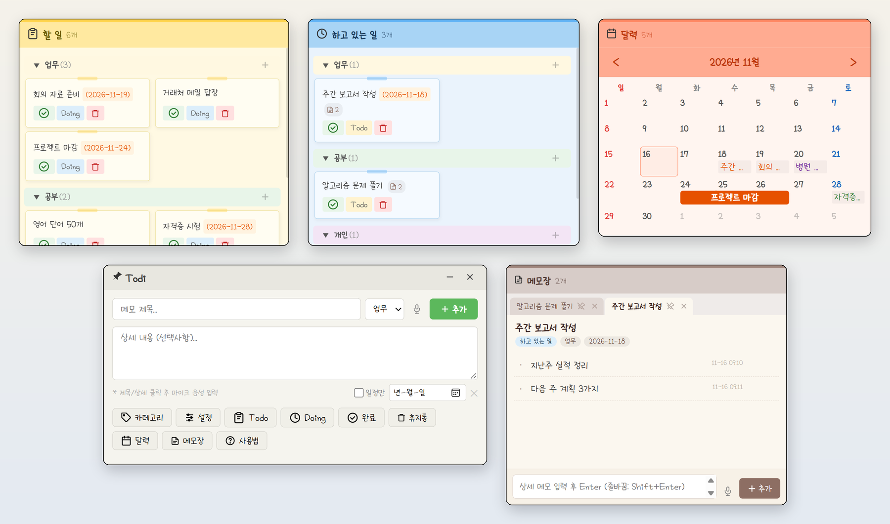
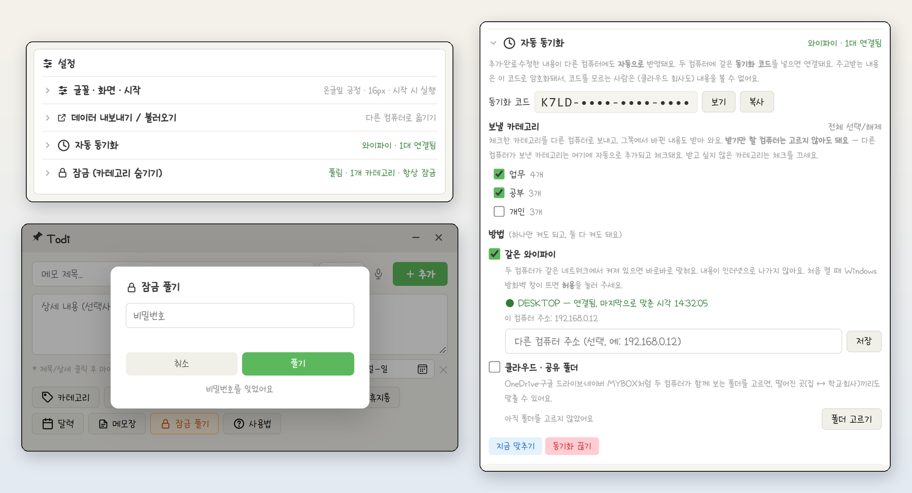

# Todi

바탕화면에 붙여 두고 쓰는 칸반 메모 앱이에요. 할 일을 카드로 만들어 **할 일 → 하고 있는 일 → 완료** 순서로 관리하고,
달력과 상세 메모장으로 일정과 메모까지 한곳에서 챙길 수 있어요.



## 다운로드

[최신 버전 다운로드](https://github.com/ssoram/Todi/releases/latest)

| OS | 파일 |
|---|---|
| Windows | `Todi_x.x.x_x64-setup.exe` |
| macOS | `Todi_x.x.x_aarch64.dmg` 또는 `Todi_vx.x.x_macos.zip` |

설치한 뒤에는 새 버전이 나오면 앱을 켤 때 자동으로 업데이트돼요.
업데이트하면 새로 생긴 기능을 스크린샷과 함께 알려 드리고, 패널의 **사용법** 버튼으로 전체 사용법을 언제든 다시 볼 수 있어요.

## 주요 기능

### 할 일 관리
- **칸반 보드** — 할 일 · 하고 있는 일 · 완료 · 휴지통이 각각 따로 된 창이라 바탕화면 어디에든 배치할 수 있어요
- **카테고리** — 카테고리별로 묶어서 보고, 접고 펴고, 끌어서 순서를 바꿀 수 있어요
- **달력** — 날짜를 정한 메모는 달력에 표시돼요. 기간 일정은 막대로, 공휴일은 빨간색으로 보여요
- **상세 메모장** — 카드를 누르면 메모장 탭이 열려서 상세 메모를 한 줄씩 쌓을 수 있어요. 탭은 인터넷 창처럼 고정하고 순서를 바꿀 수 있어요
- **메모 창** — 상세 메모 하나를 작은 창으로 따로 띄워 두고, 📌 로 고정하면 다시 켜도 그 자리에 떠 있어요
- **음성 입력** — 🎤 를 누르고 말하면 입력칸에 글자가 들어가요

### 다른 컴퓨터와 함께 쓰기


- **자동 동기화** — 두 컴퓨터에 같은 동기화 코드를 넣으면, 고른 카테고리의 추가 · 완료 · 수정이 서로 자동으로 반영돼요
  - **같은 와이파이**: 같은 공유기에 연결된 컴퓨터끼리 바로 맞춰요. 내용이 인터넷으로 나가지 않아요
  - **클라우드 · 공유 폴더**: OneDrive 같은 폴더를 함께 써서 집과 회사처럼 떨어진 곳끼리도 맞춰요
  - 주고받는 내용은 동기화 코드로 암호화돼서, 코드를 모르면 (클라우드 회사도) 내용을 볼 수 없어요
- **내보내기 / 불러오기** — 원하는 카테고리만 파일로 내보내서 다른 컴퓨터에서 불러올 수 있어요

### 잠금
- **카테고리 숨기기** — 회사 · 공용 PC에서 보이면 곤란한 카테고리를 비밀번호로 잠가요. 잠기면 모든 창에서 사라지고, 데이터 파일 안에서도 암호화돼요
- **항상 잠금 / 필요할 때만** — 켤 때마다 잠긴 채로 시작하거나, 휴가처럼 필요할 때만 잠글 수 있어요
- **복구 코드** — 비밀번호를 잊어도 복구 코드로 풀 수 있어요

### 그 밖에
- **시스템 트레이** — 창을 닫아도 트레이에 남아 있어서 언제든 다시 열 수 있어요
- **자동 시작** — 컴퓨터를 켜면 자동으로 실행돼요
- **글꼴 · 투명도 · 달력 색상** — 설치된 글꼴 중에서 고르고, 창 투명도와 달력 색을 바꿀 수 있어요
- **위치 기억** — 창 위치와 크기를 기억해서 다음에 켜도 그대로예요

## 사용법

1. **메모 추가** — 패널에서 제목을 쓰고 카테고리를 고른 뒤 **추가**(또는 Enter). 날짜를 정하면 달력에도 표시돼요
2. **상태 옮기기** — 카드의 **Doing** 버튼으로 하고 있는 일로, ✓ 버튼으로 완료로 옮겨요
3. **상세 메모** — 카드를 누르면 메모장에 그 항목의 탭이 열려요
4. **카테고리 관리** — 패널의 **카테고리** 버튼에서 추가 · 삭제 · 이름 변경 · 끌어서 정렬
5. **다른 컴퓨터와 맞추기** — **설정 → 자동 동기화**에서 코드를 만들고, 다른 컴퓨터에 그 코드를 넣어요
6. **숨기기** — **설정 → 잠금**에서 숨길 카테고리와 비밀번호를 정하고, 패널의 **잠그기** 버튼으로 잠가요

## 기술 스택

| 영역 | 기술 |
|---|---|
| 프레임워크 | [Tauri 2](https://tauri.app/) |
| 백엔드 | Rust |
| 프론트엔드 | HTML, CSS, JavaScript (프레임워크 없음) |
| 동기화 · 잠금 암호화 | ChaCha20-Poly1305, PBKDF2-HMAC-SHA256 |
| 빌드/배포 | GitHub Actions, NSIS (Windows), DMG (macOS) |
| 자동 업데이트 | tauri-plugin-updater |

## 빌드

```bash
cd sticker-tauri
npm install
npm run tauri dev     # 개발 모드
npm run tauri build   # 릴리스 빌드
```

**요구사항**: [Node.js](https://nodejs.org/) 18+, [Rust](https://rustup.rs/) 1.70+

## 라이선스

MIT
